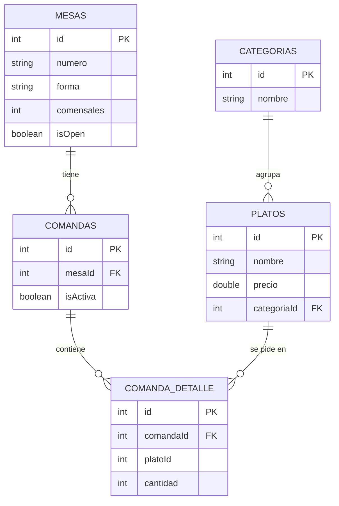

# 🍽️ RestoSync

**RestoSync** es una aplicación Android para la gestión de comandas en hostelería. Está pensada para que el camarero pueda abrir mesas, tomar nota de los pedidos y consultar la cuenta de cada mesa desde el móvil, de forma rápida y visual.

> Proyecto del módulo **Programación Multimedia y Dispositivos Móviles (PGL)** · 2.º DAM · CIFP Villa de Agüimes.
> Autora: **Jacqueline E. Díaz Hadjar**

---

## 📋 Índice

- [Funcionalidades](#-funcionalidades)
- [Capturas de pantalla](#-capturas-de-pantalla)
- [Tecnologías](#️-tecnologías)
- [Arquitectura](#️-arquitectura)
- [Base de datos](#️-base-de-datos)
- [Navegación](#-navegación)
- [Instalación y ejecución](#️-instalación-y-ejecución)
- [Limitaciones y mejoras futuras](#-limitaciones-y-mejoras-futuras)
- [Uso de Inteligencia Artificial](#-uso-de-inteligencia-artificial)

---

## ✨ Funcionalidades

- **Inicio de sesión** con formulario de usuario y contraseña *(simulado, ver [limitaciones](#-limitaciones-y-mejoras-futuras))*.
- **Mapa de mesas** en cuadrícula, cada una con el icono de su forma (cuadrada, redonda, rectangular…). Las mesas abiertas se distinguen por color y muestran el número de comensales.
- **Abrir mesa**: al pulsar una mesa libre se piden los comensales y se crea automáticamente su comanda.
- **Toma de pedidos** con un menú lateral de categorías (Entrantes, Ensaladas, Pizzas, Pastas, Postres y Bebidas) y una cuadrícula de platos con foto, nombre y precio. Cada pulsación añade el plato a la comanda de la mesa.
- **Resumen de comandas**: lista de todas las comandas con su mesa y su estado (activa o cerrada), con opción de eliminarlas.
- **Detalle de la comanda**: platos agrupados por cantidad (`2x Tiramisú`), precio por unidad, subtotal y **total de la cuenta** actualizado en tiempo real. Permite quitar unidades y añadir más platos desde el botón **+**.
- **Cerrar sesión** desde la pantalla de mesas.

---

## 📸 Capturas de pantalla

| Inicio de sesión | Mesas | Elección de platos |
|:---:|:---:|:---:|
|  |  |  |

| Abrir mesa | Resumen de comandas | Detalle de la comanda |
|:---:|:---:|:---:|
|  |  |  |

---

## 🛠️ Tecnologías

| Tecnología | Uso |
|---|---|
| **Kotlin** 2.2 | Lenguaje principal |
| **Jetpack Compose** + Material 3 | Interfaz de usuario declarativa |
| **Room** 2.8 | Base de datos local SQLite |
| **Navigation Compose** 2.8 | Navegación entre pantallas con argumentos |
| **ViewModel** + **StateFlow** | Gestión del estado según el patrón MVVM |
| **Kotlin Coroutines** + **Flow** | Operaciones asíncronas y datos reactivos |
| **KSP** | Generación del código de Room |

- **SDK mínimo:** 24 (Android 7.0)
- **SDK objetivo:** 37

---

## 🏗️ Arquitectura

El proyecto sigue el patrón **MVVM (Model–View–ViewModel)**:

```
app/src/main/java/com/example/pgl_restosync/
├── MainActivity.kt                  → Punto de entrada: crea el ViewModel y lanza la navegación
├── RestoSyncApp.kt                  → Clase Application: crea la base de datos y el repositorio una sola vez
│
├── Model/
│   ├── RestauranteRepository.kt     → Intermediario entre los DAOs y los ViewModels
│   └── Local/
│       ├── AppDatabase.kt           → Base de datos Room (Singleton)
│       ├── MesaEntity.kt            → Tabla de mesas
│       ├── FormaMesa.kt             → Enum con las formas de mesa
│       ├── CategoriaEntity.kt       → Tabla de categorías de la carta
│       ├── PlatoEntity.kt           → Tabla de platos y bebidas
│       ├── ComandaEntity.kt         → Cabecera de cada comanda
│       ├── ComandaDetalleEntity.kt  → Líneas (platos) de cada comanda
│       └── *Dao.kt                  → Consultas de cada tabla
│
├── ViewModel/
│   ├── ViewModelRestaurante.kt          → ViewModel compartido: mesas, carta y comandas
│   ├── RestauranteViewModelFactory.kt
│   ├── DetalleComandaViewModel.kt       → ViewModel propio de la pantalla de detalle
│   ├── DetalleComandaViewModelFactory.kt
│   └── DetalleUiState.kt                → Estados de la pantalla de detalle (Cargando / Éxito / Error)
│
└── View/
    ├── Navegacion.kt        → Rutas (sealed class), NavHost y barra inferior
    ├── Inicio.kt            → Pantalla de inicio de sesión
    ├── Home.kt              → Mapa de mesas y diálogo de comensales
    ├── Pedido.kt            → Elección de platos con menú lateral de categorías
    ├── ResumenPedidos.kt    → Lista de comandas
    └── DetalleComanda.kt    → Detalle y total de una comanda
```

**Flujo de datos:** las pantallas observan `StateFlow` expuestos por los ViewModels. Los ViewModels piden los datos al repositorio, que a su vez consulta Room mediante los DAOs. Como las consultas de lectura devuelven `Flow`, cualquier cambio en la base de datos se refleja automáticamente en pantalla, sin recargar.

**ViewModels:**
- `ViewModelRestaurante` se crea en `MainActivity` y se comparte entre las pantallas principales.
- `DetalleComandaViewModel` se crea dentro de la ruta del detalle, por lo que solo vive mientras esa pantalla está abierta. Gestiona su estado con un `sealed interface` (`DetalleUiState`).
- Ambos se crean mediante su **Factory**, que recibe el repositorio guardado en `RestoSyncApp`.

---

## 🗄️ Base de datos

Base de datos local con **Room** (`restosync_room.db`), formada por cinco tablas relacionadas:



**Claves foráneas con `CASCADE`:** al eliminar una comanda se eliminan automáticamente todas sus líneas de detalle.

**Consultas destacadas:**
- **Resumen de comandas**: `INNER JOIN` entre `comandas` y `mesas` para mostrar el nombre de la mesa de cada comanda, ordenadas con las activas primero.
- **Detalle de la comanda**: `JOIN` entre `comanda_detalle`, `comandas` y `platos`, agrupado con `GROUP BY` y `SUM(cantidad)`. Así, si un plato se pide varias veces, aparece en una sola línea (`3x Estrella Galicia`), y al eliminar se quita una unidad.
- **Platos por categoría**: filtrado por `categoriaId`, combinado en el ViewModel con `flatMapLatest` para que la lista cambie sola al seleccionar otra categoría.

La forma de las mesas se guarda como un **enum** (`FormaMesa`), que Room almacena como texto.

**Datos de ejemplo:** al arrancar, la app carga 6 mesas, 6 categorías y 12 platos con sus fotos.

---

## 🧭 Navegación

Las rutas están definidas en un `sealed class Navegacion`:

| Ruta | Pantalla | Barra inferior |
|---|---|:---:|
| `login` | Inicio de sesión | ❌ |
| `home` | Mapa de mesas | ✅ |
| `comandas` | Resumen de comandas | ✅ |
| `pedido/{mesaId}` | Elección de platos | ❌ |
| `detalle/{mesaId}` | Detalle de la comanda | ❌ |

- Las rutas con `{mesaId}` reciben el id de la mesa como argumento y se construyen con `crearRuta(mesaId)`.
- La barra inferior solo aparece en las pantallas principales, para dejar todo el espacio a la toma de pedidos.
- Al iniciar sesión, la pantalla de login se elimina de la pila (`popUpTo`), y al cerrar sesión se vacía la pila completa.

**Flujo habitual:**
`Login → Mesas → (abrir mesa) → Elección de platos → Comandas → Detalle → (+) → Elección de platos`

---

## ▶️ Instalación y ejecución

1. Clonar el repositorio:
   ```bash
   git clone https://github.com/Terijacquie/PGL_RestoSync.git
   ```
2. Abrir el proyecto con **Android Studio**.
3. Esperar a que Gradle sincronice las dependencias.
4. Ejecutar en un emulador o dispositivo con **Android 7.0 (API 24)** o superior.
5. En la pantalla de inicio, pulsar **Iniciar sesión** (no hace falta rellenar los campos).

---

## 🚧 Limitaciones y mejoras futuras

- **Inicio de sesión simulado**: la pantalla de login está maquetada y la navegación funciona, pero todavía no valida usuario y contraseña. Como mejora, se añadiría una tabla de usuarios en Room.
- **Reinicio de datos**: para facilitar las pruebas, la base de datos se vacía y se vuelve a cargar con los datos de ejemplo cada vez que se abre la app.
- **Imágenes de los platos**: se asignan por el id del plato en la vista. Para una carta dinámica, la imagen se guardaría como dato del plato (nombre del recurso o ruta de una foto) y se cargaría con una librería como **Coil**.
- **Cierre de mesa y cobro**: la lógica para cerrar una mesa ya existe en el ViewModel y el repositorio; falta añadir el botón en la pantalla de detalle.
- **Gestión de la carta**: añadir, editar o eliminar platos y categorías desde la propia app.

---

## 🤖 Uso de Inteligencia Artificial

Durante el desarrollo de este proyecto se ha utilizado **Claude** (Anthropic) como herramienta de apoyo, en concreto para:

- **Consultas técnicas complejas**, como el diseño de consultas SQL con `JOIN` y `GROUP BY` en Room, la navegación con argumentos en Compose o el uso de `flatMapLatest` para que los platos cambien al seleccionar una categoría (ver [detalle técnico](#-detalle-técnico-cambio-de-categoría-con-flatmaplatest)).
- **Detección y corrección de errores** de compilación y de ejecución.
- **Optimización y refactorización de código**, para hacerlo más limpio y reutilizable.
- **Estructuración y redacción de este README**, organizando la documentación del proyecto en apartados.

La idea de la aplicación, su diseño y la estructura del proyecto son propios. El código sugerido por la IA se ha revisado, comprendido y adaptado al proyecto.

---

<p align="center">Hecho con ☕ y Kotlin por <b>Jacqueline E. Díaz Hadjar</b></p>
